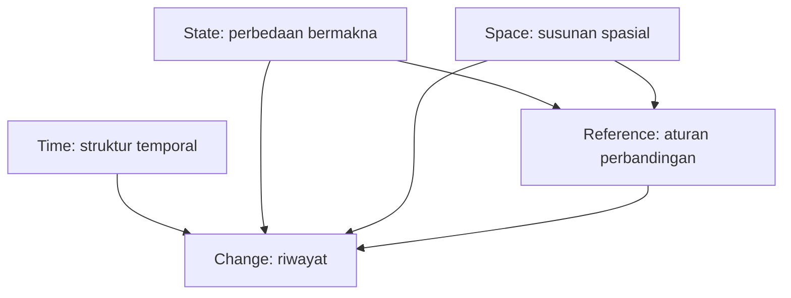
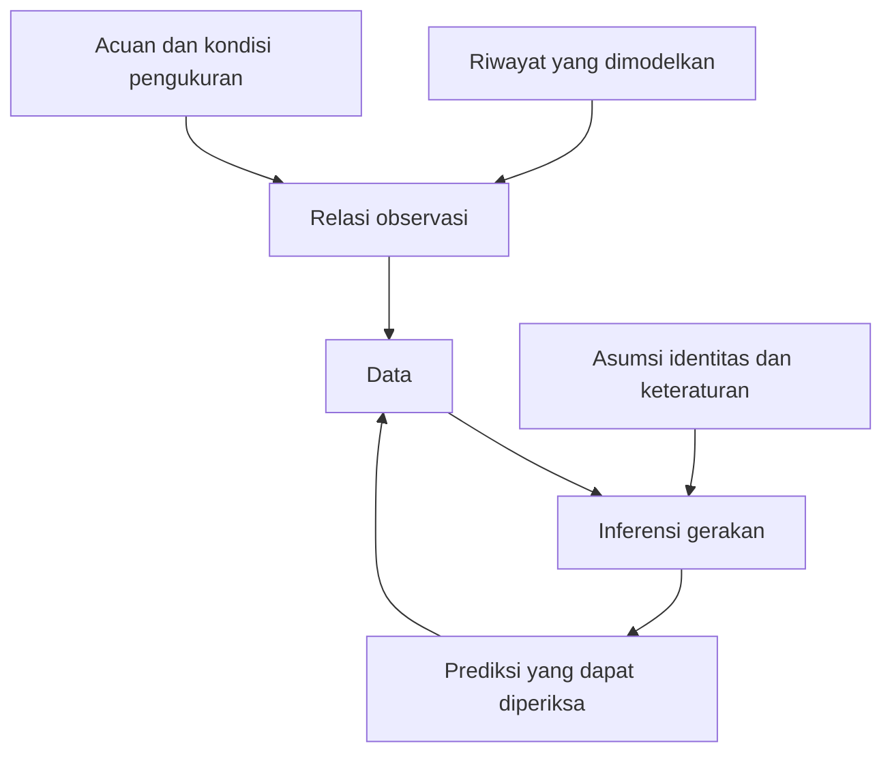

# Architecture

## Kedudukan arsitektur

Arsitektur ini memetakan syarat pengertian dan pembuktian tentang gerakan. Ia tidak mengusulkan hukum alam baru, tidak menentukan komponen perangkat lunak, dan tidak menganggap pengelompokan berkas sebagai unsur ontologis yang tidak dapat direduksi.

Temuan pengorganisasian utamanya adalah adanya dua persoalan yang berhubungan tetapi berbeda:

1. Struktur apa yang membuat suatu pernyataan tentang gerakan mempunyai arti?
2. Bukti apa yang membenarkan pernyataan bahwa gerakan tertentu terjadi?

Deskripsi matematis dapat dibentuk tanpa pengamat. Pembenaran empiris memerlukan hubungan antara deskripsi, pengukuran, dan inferensi. Karena itu, Evidence dipertahankan sebagai fondasi epistemik; ia bukan penyebab keberadaan gerakan.

Enam simpul merupakan **sintesis konseptual** dari struktur yang ditemukan dalam sumber dan diperiksa melalui contoh penyangkal. Tidak ada klaim bahwa “enam” merupakan jumlah minimum untuk semua kemungkinan teori.

## Enam simpul inti

| Simpul | Isi pokok | Alasan dipertahankan | Batasnya |
| --- | --- | --- | --- |
| [State](../Core/State.md) | Keadaan, identitas, perbedaan, kesetaraan | Tanpa kriteria perbedaan, klaim perubahan tidak terdefinisi | Tidak mengharuskan benda individual yang tetap sepanjang waktu |
| [Time](../Core/Time.md) | Urutan, durasi, parameter, waktu fisik | Perbedaan antarbenda pada satu saat belum merupakan gerakan | Tidak mengharuskan waktu global, linear, atau kontinu untuk semua teori |
| [Space](../Core/Space.md) | Posisi dan relasi spasial; konfigurasi | Perubahan umum perlu dibedakan dari perubahan susunan spasial | Ruang fisik tidak disamakan dengan semua ruang keadaan |
| [Reference](../Core/Reference.md) | Aturan membandingkan; koordinat dan transformasi | Perubahan koordinat, perubahan acuan, dan perubahan fisik dapat tertukar | Tidak menyatakan semua gerakan atau semua struktur fisik hanyalah konvensi |
| [Change](../Core/Change.md) | Riwayat dan sifat keteraturannya | Dua keadaan ujung tidak menentukan proses di antaranya | Lintasan deterministik mulus hanya salah satu model |
| [Evidence](../Core/Evidence.md) | Pemetaan observasi, ambiguitas, persepsi | Perbedaan deskripsi tidak selalu dapat diketahui dari data tersedia | Tidak menjadi teori lengkap penglihatan atau instrumentasi |

Fondasi tersebut tidak tersusun sebagai rantai sebab. State, Time, dan Space menyediakan peran konseptual berbeda; Reference menentukan perbandingan; Change menyatukannya dalam deskripsi riwayat; Evidence membahas apa yang dapat dibenarkan dari observasi.

## Peta hubungan

Pada diagram pertama, panah berarti **menyediakan struktur bagi**, dengan syarat yang dijelaskan di bawahnya. Diagram tidak menyatakan bahwa waktu diturunkan dari keadaan atau ruang merupakan konsekuensi waktu.

Panah Space menuju Change berlaku saat yang dibahas adalah gerakan spasial. Evolusi keadaan abstrak tidak selalu membutuhkan ruang fisik. Reference dapat berupa relasi internal, bukan selalu titik asal eksternal. Dalam relativitas, pemisahan Space–Time merupakan pemisahan pertanyaan untuk belajar; objek fisik dasarnya dapat berupa satu struktur ruang-waktu.

Diagram kedua membatasi hubungan epistemik:

Panah balik terakhir menunjukkan perbandingan prediksi dengan data, bukan pembuktian otomatis bahwa inferensi tunggal benar. Banyak riwayat dapat menghasilkan data yang sama.

[Relations.tsv](Relations.tsv) memuat hubungan lebih rinci dan membedakan ketergantungan definisional, penambahan struktur, spesialisasi, batas inferensi, serta keterkaitan. Tidak semua hubungan merupakan ketergantungan langsung.

## Pengetahuan elementer dan struktur tambahan

| Tingkat | Struktur | Pengertian yang tersedia |
| --- | --- | --- |
| Perbedaan | Himpunan alternatif dan kriteria kesetaraan | Sama atau berbeda |
| Riwayat | Pengaitan alternatif dengan konteks temporal | Berubah atau tetap dalam deskripsi tertentu |
| Gerakan spasial | Relasi atau konfigurasi spasial dan aturan perbandingan | Perubahan susunan spasial |
| Kontinuitas | Topologi pada domain dan kodomain riwayat | Perubahan tanpa putus dalam pengertian topologis |
| Besaran geometris | Metrik atau struktur geometris lain yang sesuai | Jarak, panjang, atau perbandingan ukuran |
| Laju lokal | Struktur diferensial dan parameter yang memenuhi syarat | Turunan atau vektor singgung |
| Dinamika | Hukum yang membatasi riwayat | Riwayat yang diizinkan oleh teori tertentu |
| Pengetahuan empiris | Relasi observasi dan pembatasan ketidakpastian | Dukungan terhadap hipotesis gerakan |

Tabel tersebut merupakan ketergantungan **bersyarat**, bukan urutan sejarah perkembangan ilmu. Metrik tidak harus didahulukan sebelum topologi. Laju juga dapat didefinisikan dalam ruang metrik tanpa diferensiabilitas manifold melalui konstruksi yang berbeda; perbedaan itu dibahas di Change.

## Hasil peninjauan kandidat awal

| Kandidat | Keputusan | Alasan |
| --- | --- | --- |
| Keberadaan | Dibahas sebagai batas ontologi dalam State | Deskripsi alternatif tidak membuktikan keberadaan fisik; bab metafisika umum tidak diperlukan |
| Identitas dan perbedaan | Digabung dalam State | Kriteria “sama” dan “berbeda” harus dinilai bersama |
| Relasi | Menjadi struktur lintas simpul | Relasi bukan satu jenis substansi yang cukup menjelaskan semua peran |
| Urutan dan waktu | Digabung dalam Time dengan pembedaan tegas | Urutan tidak otomatis memberi durasi |
| Ruang dan konfigurasi | Digabung dalam Space | Posisi tunggal tidak mencakup orientasi atau susunan sistem |
| Kontinuitas | Ditempatkan di Change sebagai tambahan bersyarat | Gerakan tidak didefinisikan secara universal sebagai kurva mulus |
| Simetri dan invariansi | Ditempatkan di Reference | Menjelaskan apa yang dipertahankan oleh perubahan deskripsi |
| Pengamatan dan persepsi | Digabung dalam Evidence, tetap dibedakan | Keduanya menyangkut pembenaran, tetapi persepsi bukan instrumen tanpa interpretasi |
| Gaya, energi, konservasi | Menjadi batas dinamika | Penting dalam teori tertentu, tidak menentukan arti dasar semua gerakan |
| Teori kuantum dan relativitas | Menjadi pembanding lintas berkas | Diperlukan untuk menguji klaim universal; tidak diperluas menjadi buku teori lengkap |

## Pemeriksaan kelengkapan

Pengisian isi memperlihatkan bahwa berkas “posisi” saja terlalu sempit: rotasi dan konfigurasi internal akan terlewat. Isi Space karena itu memuat konfigurasi. Uraian “perubahan keadaan” saja terlalu luas: perubahan temperatur bukan otomatis perpindahan. Change membedakan perubahan umum dari gerakan spasial.

Pemeriksaan juga menuntut pemisahan antara invariansi representasi dan ketakterlihatan bagi pengamat. Keduanya dapat menghasilkan data serupa, tetapi memiliki alasan berbeda. State dan Reference menangani kesetaraan representasi; Evidence menangani keterbatasan observasi.

Minimalitas yang dicapai adalah **ekonomi pengorganisasian dalam cakupan ini**: tidak ada simpul inti yang hanya berisi daftar teknik turunan; setiap simpul mengatasi kekeliruan konseptual yang berbeda. Bukti matematis bahwa tidak mungkin ada arsitektur lain yang lebih ringkas tidak tersedia dan tidak diklaim.

Penilaian rinci beserta batas pemeriksaannya tersedia dalam [Review](../Research/Review.md). Dasar–turunan dan perubahan kedudukan menurut teori dijelaskan dalam [Boundaries](Boundaries.md).
