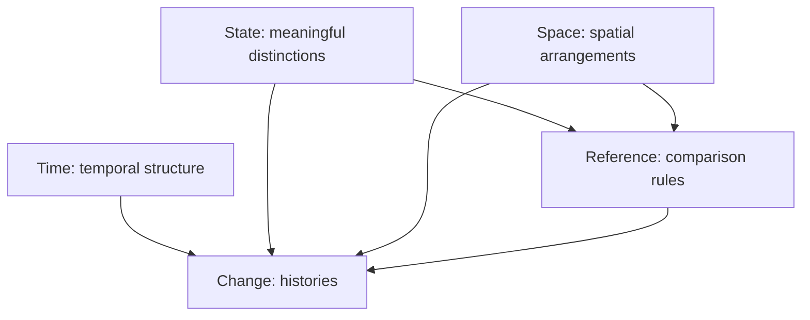
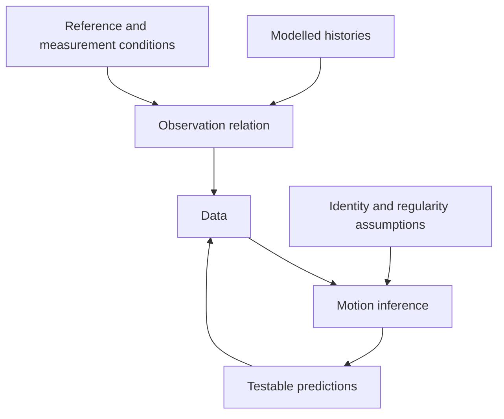

# Architecture

## Status of the architecture

This architecture maps conditions for meaningful descriptions and justification of motion. It proposes no new natural law, specifies no software components, and does not treat file groupings as irreducible ontological constituents.

Its main organizing finding is a distinction between two related questions:

1. What structures make a statement about motion meaningful?
2. What evidence justifies claiming that a particular motion occurs?

A mathematical description can exist without an observer. Empirical justification requires relations among description, measurement, and inference. Evidence is therefore retained as an epistemic foundation, not a cause of motion's existence.

The six nodes are a **conceptual synthesis** of structures found in the sources and examined through counterexamples. There is no claim that six is minimal for all possible theories.

## Six core nodes

| Node | Content | Reason for inclusion | Limit |
| --- | --- | --- | --- |
| [State](../Core/State.md) | States, identity, distinction, equivalence | Change is undefined without distinction criteria | Does not require enduring individual objects |
| [Time](../Core/Time.md) | Order, duration, parameters, physical time | Differences between objects at one instant are not yet motion | Does not require global, linear, continuous time in every theory |
| [Space](../Core/Space.md) | Positions, spatial relations, configurations | General change must be distinguished from spatial rearrangement | Physical space is not every state space |
| [Reference](../Core/Reference.md) | Comparison rules, coordinates, transformations | Coordinate, reference, and physical changes can be confused | Does not reduce every motion or physical structure to convention |
| [Change](../Core/Change.md) | Histories and regularity | End states do not determine the intervening process | Smooth deterministic trajectories are one model |
| [Evidence](../Core/Evidence.md) | Observation maps, ambiguity, perception | Available data need not reveal descriptive differences | Not a complete theory of vision or instrumentation |

These foundations do not form a causal chain. State, Time, and Space supply different conceptual roles; Reference specifies comparison; Change combines them in histories; Evidence examines observational justification.

## Relation maps

In the first diagram, arrows mean **supplies structure for**, subject to the conditions below. They do not derive time from states or space from time.

Space supplies Change when spatial motion is concerned. Abstract state evolution need not require physical space. A reference can be an internal relation rather than an external origin. In relativity, separating Space and Time separates learning questions; the physical object may be one spacetime structure.

The second diagram concerns epistemic relations:

The final return arrow compares predictions with data; it does not automatically prove a unique inference correct. Many histories can generate the same data.

[Relations.tsv](Relations.tsv) details definitional dependencies, added structures, specializations, inferential limits, and associations. Not every relation is a direct dependency.

## Elementary knowledge and additional structures

| Level | Structure | Available meaning |
| --- | --- | --- |
| Distinction | Alternatives and equality criteria | Same or different |
| History | Alternatives related to temporal contexts | Changing or constant within a description |
| Spatial motion | Spatial relations or configurations and comparison rules | Spatial rearrangement |
| Continuity | Topologies on a history's domain and codomain | Unbroken change in a topological sense |
| Geometric quantities | Metric or other suitable geometry | Distance, length, or size comparison |
| Local rate | Suitable differential structure and parameter | Derivatives or tangent vectors |
| Dynamics | Laws restricting histories | Histories allowed by a theory |
| Empirical knowledge | Observation relations and uncertainty constraints | Support for motion hypotheses |

These are **conditional** dependencies, not a historical development sequence. A metric need not precede topology. Rates can also be defined in metric spaces without manifold differentiability through another construction, as discussed in Change.

## Review of initial candidates

| Candidate | Decision | Reason |
| --- | --- | --- |
| Existence | Ontological limits in State | Formal alternatives do not prove physical existence; general metaphysics is unnecessary |
| Identity and distinction | Combined in State | Criteria of sameness and difference must be assessed together |
| Relation | Structure across nodes | Relations are not one substance explaining every role |
| Order and time | Combined in Time, clearly distinguished | Order does not automatically supply duration |
| Space and configuration | Combined in Space | A single position does not cover orientation or arrangements |
| Continuity | Conditional addition in Change | Motion is not universally defined as a smooth curve |
| Symmetry and invariance | Included in Reference | Explain what descriptive transformations preserve |
| Observation and perception | Combined in Evidence, still distinguished | Both concern justification; perception involves interpretation |
| Force, energy, conservation | Mark the boundary with dynamics | Important in particular theories, not definitions of every motion |
| Quantum theory and relativity | Comparisons across files | Test universal claims without becoming full textbooks |

## Completeness checks

Developing the content showed that “position” alone is too narrow: it misses rotation and internal configurations. Space therefore includes configuration. “State change” alone is too broad: temperature change is not automatically displacement. Change distinguishes general change from spatial motion.

Review also required separating representational invariance from observational invisibility. Both may yield similar data for different reasons. State and Reference address representational equivalence; Evidence addresses observation limits.

The achieved minimality is **organizational economy within this scope**: no core node merely catalogues derived techniques, and each addresses a different conceptual error. There is no mathematical proof that a more compact architecture is impossible.

Detailed assessment and its limits appear in [Review](../Research/Review.md). Foundational–derived boundaries and theory-relative roles are explained in [Boundaries](Boundaries.md).
