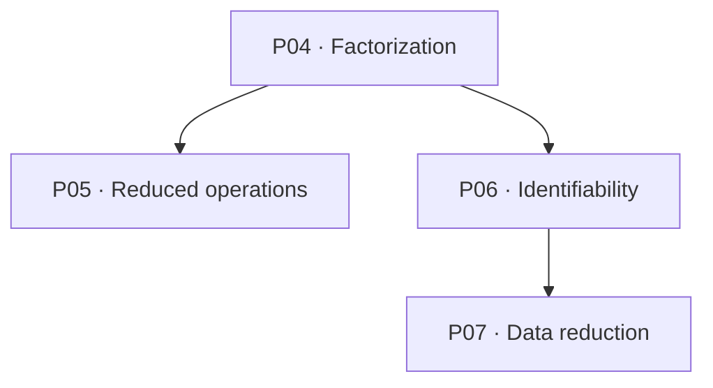

# Kinesis · κίνησις

**The fundamental knowledge of motion — connected, examined, and traceable.**

Kinesis is a scientific library about the roots of motion: how states are distinguished, changes compared, histories understood, and conclusions justified by evidence.

The name comes from Ancient Greek **κίνησις**, meaning motion. The scientific documents retain **Motion** as their subject identity.

## Explore

| Layer | Question | Start here |
| --- | --- | --- |
| **Foundation** | What makes motion meaningful? | [Architecture](Foundation/Structure/Architecture.md) |
| **Synthesis** | What follows when the foundations are connected? | [Synthesis overview](Synthesis/Overview.md) |
| **Graph** | How can concepts, premises, results, and sources be traced? | [Map guide](Graph/README.md) |

## Foundation

| Foundation | Focus |
| --- | --- |
| [State](Foundation/Core/State.md) | States, identity, distinctions, and equivalence |
| [Time](Foundation/Core/Time.md) | Order, duration, parameters, and physical time |
| [Space](Foundation/Core/Space.md) | Positions, spatial relations, configurations, and geometry |
| [Reference](Foundation/Core/Reference.md) | References, transformations, and invariance |
| [Change](Foundation/Core/Change.md) | Histories, continuity, and conditions for rates |
| [Evidence](Foundation/Core/Evidence.md) | Observation, inference, identifiability, and perception |

These six parts are a revisable organization of knowledge, not six natural axioms or a proof of universal minimality.

## Synthesis

The synthesis develops arguments with explicit premises, derivations, counterexamples, and limits.

| Discussion | Main results |
| --- | --- |
| [Comparison](Synthesis/Comparison.md) | Consistent comparison, levels of invariance, and partial orders |
| [Reduction](Synthesis/Reduction.md) | Descriptive sufficiency and conditions for reduced operations and evolution |
| [Evidence](Synthesis/Evidence.md) | Property identifiability and geometric motion bounds from data |
| [Stationarity](Synthesis/Stationarity.md) | Constancy of states, observables, distributions, statistics, and currents |
| [Limits](Synthesis/Limits.md) | Additional premises, types of justification, and limits of unification |

The recorded primary proof dependencies are:

Arrows point from a result to a proof using it. Other conceptual connections are recorded separately in [Trace.tsv](Synthesis/Trace.tsv).

## Knowledge map

[Graph/Model.json](Graph/Model.json) contains:

- **498 entities** and **1,448 relationship or attribute records**.
- **28 source documents** with content and version-specific text anchors.
- **186 document sections**, **43 claim entries**, and **45 conditional relations**.
- Six foundations, 13 synthesis results, a glossary, and 25 bibliographic records.

The query context is **documentation**. An accepted mapping record means the document representation was accepted; each source claim retains its scientific status. This does not claim formal verification of all mathematics or universal truth of all content.

The repository model is an English derivative of the recorded Graph export. Its source snapshots, labels, and UTF-16 anchors have been translated and checked locally. [Record.json](Graph/Record.json) distinguishes this edition from the upstream Graph revision and validation.

## Reading paths

- **Learn the foundations:** [Architecture](Foundation/Structure/Architecture.md) → six core files → [Boundaries](Foundation/Structure/Boundaries.md).
- **Follow the reasoning:** [Overview](Synthesis/Overview.md) → relevant discussion → [Trace](Synthesis/Trace.tsv) → sources.
- **Examine quality:** [Foundation Review](Foundation/Research/Review.md), [Synthesis Review](Synthesis/Review.md), and [Graph Checks](Graph/Checks.md).
- **Explore references:** [Foundation Sources](Foundation/Research/Sources.md) and [Synthesis Sources](Synthesis/Sources.md).

## Repository

| Location | Content |
| --- | --- |
| Foundation/Core/ | Six scientific foundation documents |
| Foundation/Structure/ | Architecture, boundaries, glossary, and relations |
| Foundation/Research/ | Sources, claim trace, review, and open questions |
| Synthesis/ | Cross-foundation derivations and argument traces |
| Graph/ | Model export derivative, provenance, and mapping checks |
| [Checksums.tsv](Checksums.tsv) | Repository file SHA-256 checksums |

All repository prose, tables, diagrams, and embedded graph text are in English, using standard scientific terminology and notation.

This edition translates the original Indonesian corpus. [Origins.tsv](Synthesis/Origins.tsv) distinguishes original source hashes from English foundation hashes. Scientific assumptions, qualifications, and proof dependencies are retained.

Download the organized project with GitHub's **Code → Download ZIP**, or use the [ZIP download](https://github.com/arsafiqri-aybi/kinesis/archive/refs/heads/main.zip).

## Scientific scope

Kinesis concerns motion's foundations. Definitions, conditional mathematical results, model assumptions, interpretations, empirical findings, and open questions retain distinct statuses.

The available reviews are internal and state their limitations. The knowledge remains open to traceable correction and further derivation.

Applied theories, animation, simulation, and technological implementation are beyond the core library's scope.
