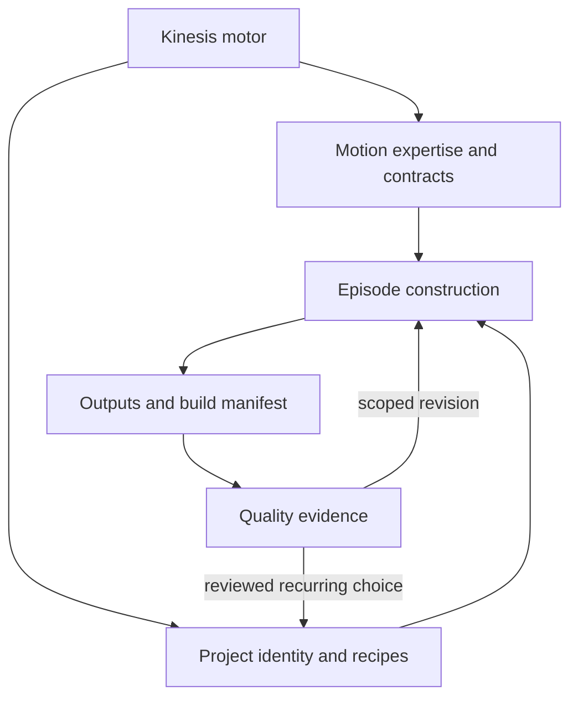

# Architecture

## Ownership

The motor coordinates intent, responsibility and evidence. Motion supplies reusable media expertise. A project selects its own references, design grammar and reusable recipe parameters. An episode supplies content, exact timing and scoped exceptions. Outputs contain the actual generated media.

The base knowledge graph and project overlay are separate data sources with shared endpoint IDs. Contract ownership is a routing relationship, not evidence that a software engine has been implemented. Handoff edges carry explicit conditions and payloads; taxonomy proximity does not establish dependency.

## Revisions

Change at the narrowest responsible layer. A new font invalidates affected text measurements and layout review. New speech invalidates alignment and dependent cues. A camera or crop change invalidates projected tracking and protected bounds. Keep unrelated approved decisions stable.

Record `pass`, `fail`, `stale` or `unverified` with actual observation scope. An intentional exception needs a reason and review. A non-applicable production gate needs an explicit reason; silent work need not invent an audio inspection.

See [Project Architecture](../Engine/Motion/System/Project-Architecture.md) for detailed inheritance and [Quality Intelligence](../Engine/Motion/System/Quality-Intelligence.md) for fault discovery.
